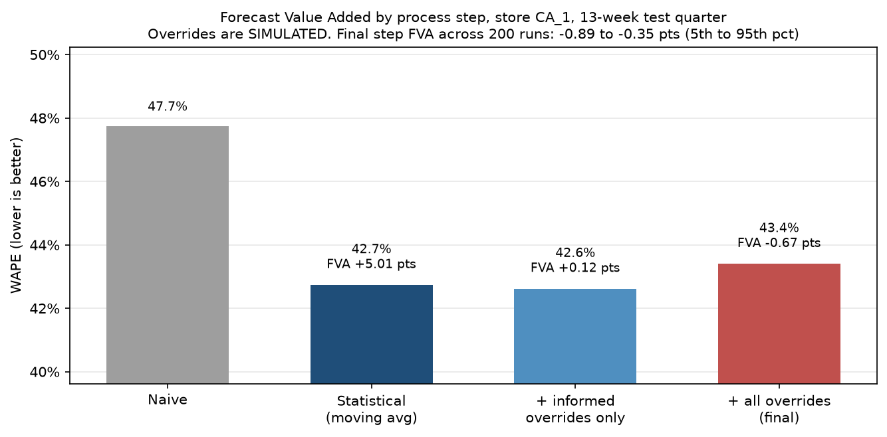

# Supply Chain Analytics Portfolio

Akash | MS Business Analytics (Supply Chain Analytics), UMass Amherst Isenberg, expected May 2027

Projects focused on two areas of supply chain: **Demand Planning** and **Supply Chain Strategy**. Each project starts with a business question and ends with a decision recommendation.

## Projects

| # | Project | Business question | Tools | Status |
|---|---------|-------------------|-------|--------|
| 1 | [Forecast Accuracy Benchmark + FVA](project-1-forecast-fva/) | Which forecasting method should a planner use, and do manual overrides add value? | Python | Complete |
| 2 | [Forecast-to-Inventory Policy Tool](project-2-inventory-policy/) | How much safety stock does forecast error require, and what does it cost? | Python, Excel, VBA | In progress |
| 3 | S&OP Scenario Simulator | How should we close the gap between demand and capacity? | Python, Power BI | Planned |
| 4 | New England Network Design + Monte Carlo | Where should distribution centers go, and how robust is that choice? | Python, PuLP | Planned |
| 5 | M5 Hierarchical Forecasting | How do SKU, category, and store forecasts reconcile? | Python | Planned |

Projects 1 to 3 share one dataset (Walmart M5, store CA_1) and tell one connected story:

```
Project 1: Which forecast?  ->  Project 2: How much inventory does its error require?  ->  Project 3: Can capacity meet the plan?
   forecast error (WAPE, bias)       safety stock, reorder point, inventory $                gap-closing options, S&OP recommendation
```

## Skills shown
| Skill | Where |
|---|---|
| Python (pandas, statsmodels, LightGBM) | Projects 1, 2 |
| Forecast accuracy metrics (WAPE, bias, FVA) | Project 1 |
| Inventory policy (safety stock, reorder point, EOQ) | Project 2 |
| Excel modeling and VBA automation | Project 2 |
| Power BI | Project 3 (planned) |
| Monte Carlo simulation | Project 1 (planner overrides), Project 4 (planned) |
| Optimization (PuLP) | Project 4 (planned) |

## Project 1 highlights
- Benchmarked 5 forecasting methods on 2,717 Walmart SKUs over a 13-week quarter. A 4-week moving average beat naive by 5.0 WAPE points (42.7% vs 47.7%) and beat Holt-Winters and LightGBM overall
- Found that the best method depends on horizon: moving average for weeks 1 to 8, LightGBM for weeks 9 to 13
- Built a Forecast Value Added framework with simulated planner overrides: only overrides with a documented reason (price changes) improved accuracy; uninformed adjustments made it worse in every scenario tested



## Repository layout
Each project folder has its own README (Business Question, Data, Approach, Results, Recommendation, Limitations, How to Run) and its own `requirements.txt`. Raw Kaggle files are not committed; each project explains how to download them.
