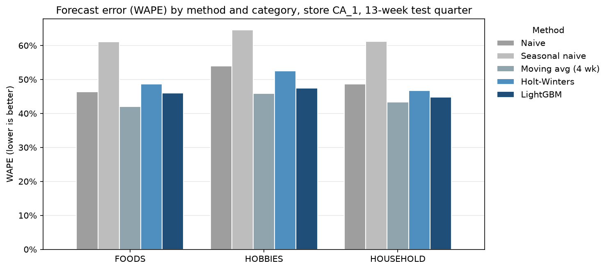
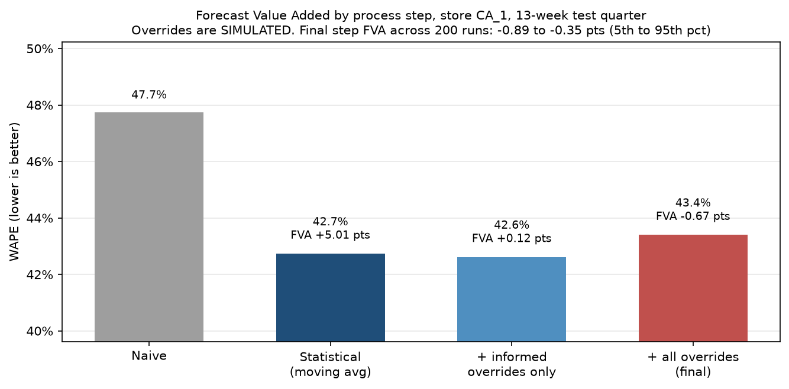

# Project 1: Forecast Accuracy Benchmark + Forecast Value Added (FVA)

**Tools:** Python (pandas, statsmodels, LightGBM, matplotlib) | **Data:** Walmart M5, store CA_1 | **Status:** Complete | **Next:** [Project 2](../project-2-inventory-policy/) turns this forecast error into safety stock

## Business Question
Which forecasting method should a planner use for each product group, and do manual planner adjustments add value or destroy it?

## Data
Walmart M5 Forecasting - Accuracy (Kaggle): https://www.kaggle.com/c/m5-forecasting-accuracy

- Files used: `sales_train_evaluation.csv`, `calendar.csv`, `sell_prices.csv`
- Subset: store CA_1, daily sales summed to Walmart fiscal weeks (Saturday to Friday)
- 3,049 SKUs, 277 full weeks (2011-01-29 to 2016-05-14), 683,167 SKU-weeks after cleaning
- 161,406 pre-launch rows removed (weeks before an item's first price; all had 0 units, so they were not real zero demand)
- 20.7% of SKU-weeks have zero sales, which drove the choice of accuracy metric (see Approach)
- Raw files are not stored in this repo (too large). See How to Run.

## Approach
| Notebook | What it does |
|---|---|
| `01_load_and_subset.ipynb` | Loads M5 in chunks, keeps CA_1, reshapes wide to long, joins calendar and prices, aggregates to weekly, runs data checks |
| `02_baseline_forecasts.ipynb` | Forecasts a 13-week test quarter (2016-02-20 to 2016-05-14) with 5 methods and scores them |
| `03_fva.ipynb` | Measures Forecast Value Added for each process step, simulates planner overrides, tests override policies |

**Forecast setup**
- Fixed origin: all 13 weeks forecast at once from the end of training, the way a quarterly plan is made
- Scored 2,717 SKUs with at least 2 years of history (needed for yearly seasonality). 332 newer SKUs excluded
- Methods: naive, seasonal naive, 4-week moving average, Holt-Winters (damped trend, 52-week seasonality, one model per SKU), LightGBM (one global Tweedie model)
- LightGBM uses only sales lags of 13+ weeks, so it never sees data it would not have at forecast time (no leakage)

**Metrics** ($A$ = actual units, $F$ = forecast units, summed over SKU-weeks)
- **WAPE** $= \sum|A-F| / \sum A$ (primary). Works with zero-sales weeks and weights big sellers more
- **Bias** $= \sum(F-A) / \sum A$. Negative = under-forecast (stockout risk), positive = over-forecast (excess inventory)
- **MAPE** shown for reference only. It cannot be computed on zero-sales weeks and over-weights slow sellers
- **FVA** $= \text{WAPE}_{\text{previous step}} - \text{WAPE}_{\text{this step}}$, in points. Positive = the step improved the forecast

**Planner overrides are simulated.** M5 has no planner data. Notebook 03 simulates two override types: informed overrides (a planner adjusts for a known price change using an assumed elasticity of -1.5, without seeing actual sales) and uninformed "tinkering" (random adjustments with an upward bias). Results are averaged over 200 Monte Carlo runs and tested with a sensitivity analysis.

## Results

### 1. The simplest smoother was the most accurate (real results)


| Method | WAPE | Bias | FVA vs naive |
|---|---|---|---|
| Moving avg (4 wk) | **42.7%** | -5.5% | **+5.0 pts** |
| LightGBM | 46.0% | -8.4% | +1.8 pts |
| Naive | 47.7% | -4.9% | baseline |
| Holt-Winters | 48.7% | -0.8% | -0.9 pts |
| Seasonal naive | 61.5% | -3.4% | -13.8 pts |

- The moving average won overall and in every category: FOODS 42.0%, HOBBIES 45.9%, HOUSEHOLD 43.3%
- **Horizon matters:** the moving average was best for weeks 1 to 8 (33.6% WAPE at 1 week ahead). LightGBM was best for weeks 9 to 13 (41.9% to 45.1%), because it uses seasonality and price instead of recent sales
- **Every method under-forecast.** LightGBM under-forecast FOODS by 12.6%. FOODS sales grew about 15% this quarter vs the prior 13 weeks, and LightGBM's newest sales information was 13 weeks old
- Holt-Winters had almost no bias (-0.8%) but was not accurate. Low bias and low error are different things
- MAPE ranked LightGBM best, WAPE ranked the moving average best. MAPE over-weights slow sellers: the bottom third of SKUs are 5% of units

### 2. Overrides only add value when they bring new information (simulated)


| Process step | WAPE | FVA vs previous step |
|---|---|---|
| Naive | 47.74% | |
| Statistical forecast (moving avg) | 42.73% | +5.01 pts (real) |
| + informed (price) overrides only | 42.61% | +0.12 pts (simulated) |
| + all overrides | 43.40% | -0.67 pts (simulated) |

- **Real finding:** weeks with a price change of 5% or more had 73.5% WAPE vs 41.9% elsewhere. The moving average cannot react to price
- **Informed overrides** improved WAPE by 6.5 pts on the 1.5% of SKU-weeks they touched. Positive for every elasticity tested (-0.5 to -3)
- **Tinkering destroyed value** in all 200 runs and in every cell of the sensitivity grid. Upward tweaks did the most damage
- **Policy test (200-run average):** requiring a reason code gave the lowest WAPE (42.61%) while touching 1.5% of SKU-weeks. Accepting every override gave 43.33% while touching 16.6%
- **Real finding:** 39 SKUs had a forecast of 0 when their price changed (likely back in stock or relaunched), then sold 2,642 units. A % override cannot fix a forecast of 0

## Decision / Recommendation
1. **Replace naive with a 4-week moving average** as the baseline statistical forecast. It cut error by 5.0 points (about 10%) at no cost.
2. **Use the moving average for weeks 1 to 8 and LightGBM for weeks 9 to 13** of the quarterly plan. Confirm this split on an earlier backtest quarter before adopting it, since it was chosen on the test quarter.
3. **Accept planner overrides only with a reason code** (price change, promotion, known event), and report FVA by reason code every month. Keep a reason code only while its FVA stays positive.
4. **Fix the FOODS under-forecast in the model, not with overrides.** Test a shorter window or a trend term and check it with FVA.
5. **Create a separate process for items coming back into stock**, where the planner enters a unit forecast instead of a % adjustment.

## Limitations
- **Planner overrides are simulated, not real.** Override FVA depends on the assumed touch rates, bias, noise, and elasticity. The method transfers to a real override log; the exact numbers do not
- M5 records sales, not demand. Stockouts hide unmet demand, so demand may be understated
- One store, one 13-week test quarter (includes Easter 2016). Results may differ in other stores and seasons
- The moving average and the horizon split were chosen on the same test quarter they were scored on
- LightGBM was not tuned. Test-quarter prices and events were treated as known in advance
- Holt-Winters used default fitting. Some per-SKU fits raise convergence warnings; notebook 02 reports how many. Their forecasts were kept, which may understate Holt-Winters a little
- 332 SKUs with under 2 years of history were excluded from the benchmark

## How to Run
1. Install requirements: `pip install -r requirements.txt` (Python 3.11)
2. Get a Kaggle API token (Kaggle > Settings > API > Create New Token) and place `kaggle.json` in `~/.kaggle/`
3. Accept the competition rules on the Kaggle competition page
4. Download the data: `python data/download_data.py`
5. Run the notebooks in `notebooks/` in numbered order (01, 02, 03). Notebook 03 uses a fixed random seed, so results reproduce exactly

## Folder Structure
```
project-1-forecast-fva/
├── data/
│   ├── raw/          # Original Kaggle files (not committed)
│   ├── processed/    # Weekly subset, forecasts, simulated override log
│   └── download_data.py
├── notebooks/        # 01 load, 02 forecasts, 03 FVA
├── outputs/figures/  # Charts used in this README
└── requirements.txt
```
