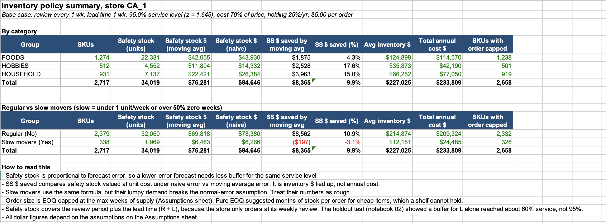
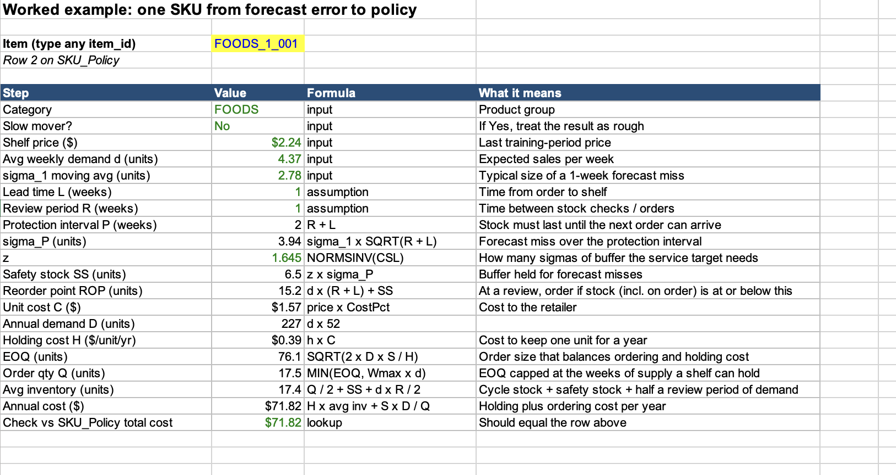
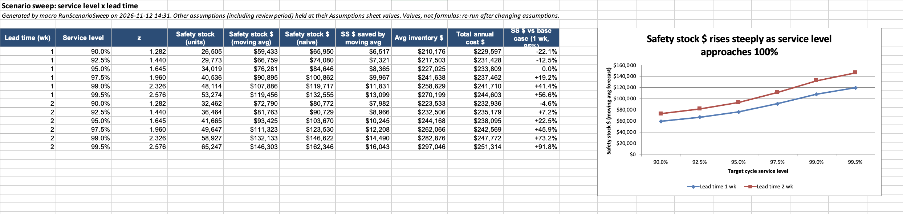
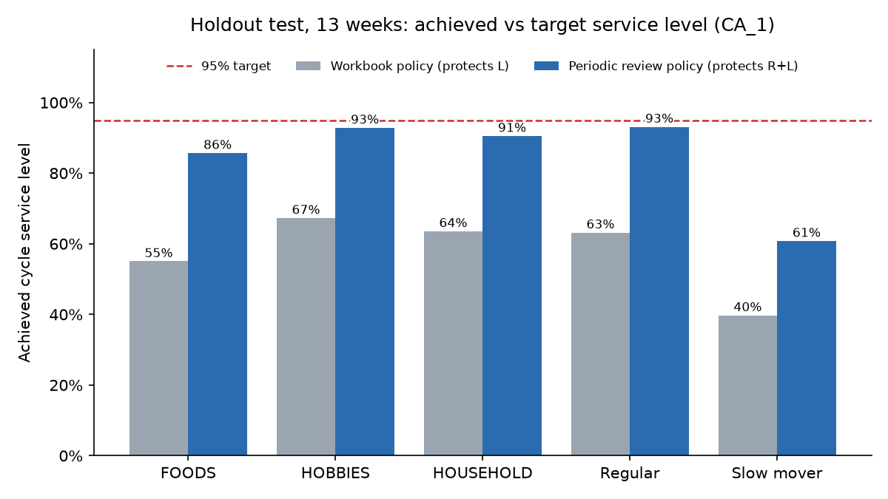
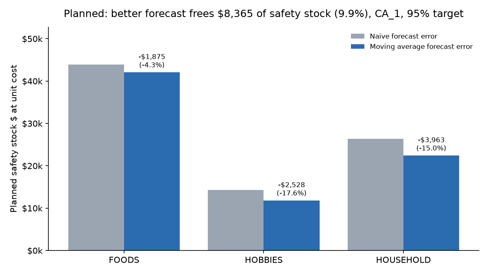
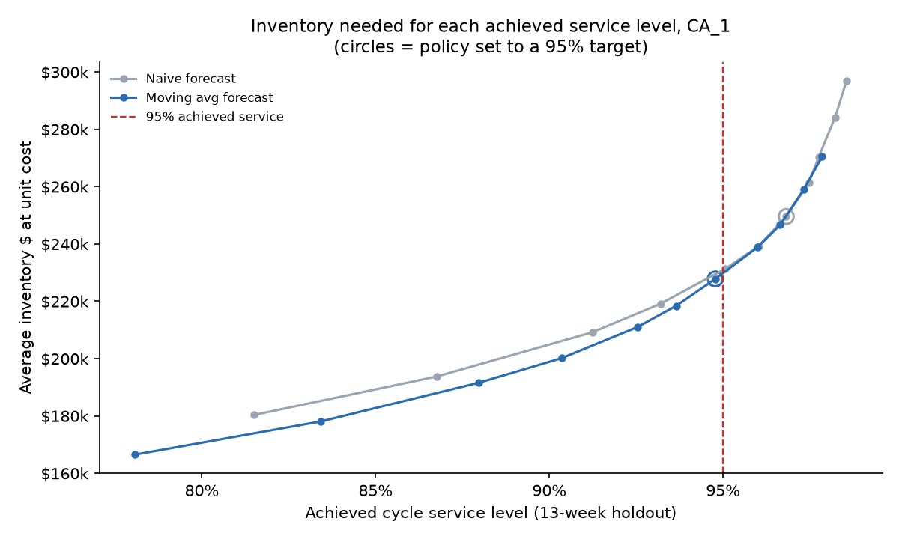

# Project 2: Forecast-to-Inventory Policy Tool

**Tools:** Python (data prep, replenishment simulation), Excel (policy model), VBA (scenario automation) | **Data:** Walmart M5, store CA_1 (same 2,717 SKUs as [Project 1](../project-1-forecast-fva/)) | **Status:** Complete

## Business Question
How much safety stock does each SKU need to hit a target service level, what does that inventory cost to hold, and how many dollars does a more accurate forecast free up?

## Data
- Inputs come from Project 1's processed weekly data (`project-1-forecast-fva/data/processed/`)
- `data/sku_policy_inputs_CA_1.csv`: one row per SKU with average demand, 1-week forecast error (naive and moving average), bias, and a slow-mover flag
- `data/holdout_demand_CA_1.csv`: actual weekly demand in the 13-week holdout quarter, used to test the policy
- `data/holdout_results_CA_1.csv`: per-SKU holdout simulation results (lost units, replenishment cycles, stockout cycles, average inventory) from notebook 02
- M5 has no lead times, unit costs, or ordering costs. These are **assumptions** set on the Excel Assumptions sheet:

| Assumption | Base case | Why |
|---|---|---|
| Lead time $L$ | 1 week | Store shelves are replenished weekly from a distribution center |
| Review period $R$ | 1 week | The store checks stock and orders once a week. Added after the Step 4 holdout test |
| Unit cost $C$ | 70% of last training-period shelf price | M5 has retail prices only |
| Holding rate $h$ | 25% per year | Typical range is 20 to 30% (capital, space, shrink) |
| Cost per order $S$ | $5 per SKU order | Handling and receiving at store level |
| Service target | 95% cycle service level ($z$ = 1.645) | Common retail base case; swept from 90% to 99.5% in VBA |
| Max order size $W_{max}$ | 4 weeks of average demand | Shelf space and shelf life. Pure EOQ gave about 17 weeks of supply per order for a typical FOODS item |

## Approach
| Step | What it does | Status |
|---|---|---|
| 1 | `notebooks/01_policy_inputs.ipynb`: rolling 1-week-ahead backtest over the last 52 training weeks to measure forecast error per SKU | Done |
| 2 | `excel/inventory_policy_CA_1.xlsx` (built by `scripts/build_workbook.py`): Assumptions, Summary, SKU_Policy (2,717 rows of live formulas), and SKU_Example (one SKU worked end to end) | Done |
| 3 | `vba/ScenarioSweep.bas`: macro that runs 12 scenarios (service level 90% to 99.5%, lead time 1 and 2 weeks), writes a Scenarios sheet and trade-off chart, and restores the inputs | Done |
| 4 | `notebooks/02_holdout_test.ipynb`: replay the 13-week holdout quarter week by week (weekly review, 1-week lead time, lost sales) and compare achieved vs target service level. Tests the workbook policy and a periodic review version that protects review period + lead time | Done |
| 5 | `notebooks/03_dollar_impact.ipynb`: safety stock $ with naive vs moving average error (planned), then both policies replayed on the holdout with weekly-updated forecasts and compared at equal achieved service (realized) | Done |
| 6 | Results, recommendation, and limitations (this README) | Done |

**Formulas** (periodic review, reorder point policy)
- $\sigma_1$ = RMSE of 1-week-ahead forecast error, in units
- $L$ = replenishment lead time, $R$ = review period, both in weeks
- $\sigma_P = \sigma_1 \sqrt{R + L}$ = forecast error over the protection interval $R + L$ (assumes weekly errors are independent). With weekly review, stock must last until an order placed at the next review arrives
- $z$ = standard normal value for the target cycle service level (for example 1.645 for 95%)
- Safety stock $SS = z \cdot \sigma_P$
- Reorder point $ROP = \bar{d} \cdot (R + L) + SS$, where $\bar{d}$ = forecast weekly demand
- $D$ = annual demand $= 52 \bar{d}$; $S$ = cost per order; $H$ = annual holding cost per unit $= h \cdot C$, where $h$ = holding rate and $C$ = unit cost
- Order quantity $EOQ = \sqrt{2DS / H}$, capped: $Q = \min(EOQ,\ W_{max} \cdot \bar{d})$
- Average inventory $= Q/2 + SS + \bar{d} R / 2$ (orders go out only at reviews, so on average half a review period of demand is still on the shelf when an order arrives); annual cost $= H \cdot$ average inventory $+ S \cdot D / Q$

## Results

### 1. Forecast error sets the buffer (Step 1)
- Over the last 52 training weeks, the 4-week moving average had 8.4% less 1-week forecast error than naive (sum of RMSE: 14,625 vs 15,957 units). It was lower for 85.7% of SKUs
- The gain was uneven: HOBBIES -18.3%, HOUSEHOLD -15.1%, FOODS only -3.5%
- 338 of 2,717 SKUs (12.4%) are slow movers (under 1 unit a week or over 50% zero weeks). They carry 2.4% of units and are reported separately

### 2. The Excel policy tool (Steps 2 and 3)
2,717 SKUs, all live formulas driven by the yellow inputs on the Assumptions sheet. Base case (review 1 week, lead time 1 week, 95% target):



| Measure | Base case |
|---|---|
| Safety stock | 34,019 units, $76,281 at unit cost |
| Average inventory | $227,025 |
| Total annual cost (holding + ordering) | $233,809 |
| SKUs where the 4-week order cap binds | 2,658 |

The SKU_Example sheet walks one item from forecast error to order quantity, so every number can be traced:



**Service level is expensive, and the cost is nonlinear** (VBA scenario sweep, 12 scenarios):



- 95% to 99% service: safety stock +41.4% ($76,281 to $107,886). 99.5%: +56.6%
- Dropping to 90%: -22.1% ($59,433)
- Lead time 1 to 2 weeks at 95%: +22.5% ($93,425), because the protection interval grows from 2 to 3 weeks ($\sqrt{3/2}$)
- Worst case tested (2-week lead time, 99.5%): $146,303, +91.8% vs base

### 3. Holdout test: the textbook formula missed the target (Step 4)
The policy was replayed week by week on the 13-week holdout quarter (2,708 SKUs with a policy; weekly review, 1-week lead time, unmet demand lost).



| Policy | Cycle service level | Fill rate | Safety stock $ |
|---|---|---|---|
| Original: buffer covers lead time $L$ only | 60.0% | 90.8% | $53,923 |
| Periodic review: buffer covers $R + L$ | 88.5% | 97.2% | $76,258 |
| Periodic review, forecast updated weekly (Step 5) | 94.8% | 99.0% | $76,258 |

- **Cause:** the original formula assumes continuous review (order the moment stock hits the reorder point). The store orders once a week, so stock must last review period + lead time = 2 weeks. Even on synthetic demand that meets every formula assumption, the original policy reached only 69.8% (regular SKUs)
- **Fix:** sizing for $R + L$ costs +41.4% safety stock and lifts service to 88.5% with a fixed forecast. With the forecast updated each week, as a store would run it, service reaches 94.8%, on target
- **Slow movers fall short even with the fix:** 60.8% service, 74.5% fill rate (fixed forecast). The normal-error formula does not fit items that sell 0 to 2 units most weeks
- The result holds with a different starting inventory (service moved under 2 points)

### 4. Dollar impact of a better forecast: planned vs realized (Step 5)
**Planned (formula):** the moving average frees $8,365 of safety stock vs naive (9.9%), about $2,091 a year in holding cost. HOBBIES -17.6%, HOUSEHOLD -15.0%, FOODS -4.3%. Slow movers need 3.1% more.



**Realized (holdout replay, weekly-updated forecasts):** at the same 95% target the two forecasts did not deliver the same service. Naive reached 96.8% with $249,587 average inventory; the moving average reached 94.8% with $227,803. To compare fairly, both policies were run at targets from 60% to 99.5% and compared at equal *achieved* service:



| Achieved service | Avg inventory, naive | Avg inventory, moving avg | Saved |
|---|---|---|---|
| 85% | $189,284 | $182,774 | $6,510 (3.4%) |
| 90% | $204,932 | $198,899 | $6,033 (2.9%) |
| 95% | $230,942 | $229,866 | $1,076 (0.5%) |
| 97% | $252,929 | $253,217 | -$288 (-0.1%) |

- At 95%, by group: HOUSEHOLD saves 4.2%, regular SKUs 2.0%, HOBBIES 1.8%. FOODS needs 1.5% *more* with the moving average
- **Why realized is smaller than planned:** the naive forecast swings almost as much as demand (summed SD 11,655 vs 11,768 units; moving average 6,402). Each jump up triggers an order that cannot be undone, so the naive policy held $12,231 (5.2%) more stock than its own plan, and that hidden buffer bought extra service. The moving average held what it planned (-0.5%). The safety stock formula only sees forecast error, not how much the forecast moves

## Decision / Recommendation
1. **Size safety stock for the review period plus the lead time.** A store that orders weekly with a 1-week lead time needs a 2-week buffer. The lead-time-only formula delivered 60% service against a 95% target. This is the most important fix, and it costs +41.4% safety stock ($53,939 to $76,281 in the workbook).
2. **Update the forecast every week and recompute the reorder point.** With a fixed quarterly forecast the corrected policy reached 88.5%; with a weekly forecast it reached 94.8%.
3. **Use the 4-week moving average, but do not book the formula's $8,365 saving.** Its real advantage is steadier orders that land on the service target. At equal service it saved $1,076 at 95% and about $6,000 at 85 to 90%. Report the realized figure, and validate any forecast-driven inventory saving on held-out demand at equal service before it goes into a budget.
4. **Choose the service target per category on purpose.** Going from 95% to 99% costs +41.4% safety stock. A lower target for low-margin items frees cash, and it is also where the better forecast saves the most.
5. **Plan slow movers separately** (338 SKUs). Even the corrected policy gave them 60.8% service. Next step: a count-based method (for example Poisson demand) or a fixed minimum shelf quantity.

## Limitations
- M5 records sales, not demand. Stockouts hide unmet demand, so the holdout may understate true demand and overstate service
- Lead time, review period, unit cost, holding rate, and ordering cost are assumptions, not Walmart data. Dollar figures move with them
- One store and one 13-week holdout quarter. The realized savings come from interpolating 11 runs per forecast and are directional, not precise
- Scaling 1-week error by $\sqrt{R + L}$ assumes independent weekly errors. A quick check outside the notebooks suggested real 2-week errors are larger than this scaling implies for both forecasts. A next step is to measure error over the protection interval directly. The corrected policy still reached its target in the replay, partly because weekly review leaves about half a week of extra stock on average
- The normal-error formula does not fit slow movers; their results are reported but not fixed
- Order quantity is fixed for the quarter (EOQ capped at 4 weeks) and does not move with the weekly forecast
- 9 SKUs with no sales in the calibration year have no policy and were excluded from the holdout tests

## How to Run
1. Complete Project 1 first (this project reads its processed data)
2. Install requirements: `pip install -r requirements.txt` (Python 3.11)
3. Run `notebooks/01_policy_inputs.ipynb`, `02_holdout_test.ipynb`, then `03_dollar_impact.ipynb` (notebook 03 also reads Project 1's `weekly_sku_CA_1.parquet` for the last 4 training weeks)
4. Open `excel/inventory_policy_CA_1.xlsm` (or the macro-free `.xlsx`) and change the yellow cells on the Assumptions sheet. To refresh the Scenarios sheet, run macro `RunScenarioSweep`. To rebuild the workbook from the CSV: `pip install openpyxl` then `python scripts/build_workbook.py data/sku_policy_inputs_CA_1.csv excel/inventory_policy_CA_1.xlsx`

## Folder Structure
```
project-2-inventory-policy/
├── data/             # SKU inputs and holdout demand exported by notebook 01
├── notebooks/        # 01 policy inputs, 02 holdout test, 03 dollar impact
├── excel/            # Inventory policy workbook (.xlsx; .xlsm with the macro)
├── scripts/          # build_workbook.py: writes the Excel model from the notebook 01 CSV
├── src/              # inventory_sim.py: weekly replenishment simulator used by notebook 03
├── vba/              # Exported VBA modules (.bas) so the code is readable on GitHub
├── outputs/figures/  # Charts and Excel screenshots used in this README
└── requirements.txt
```
